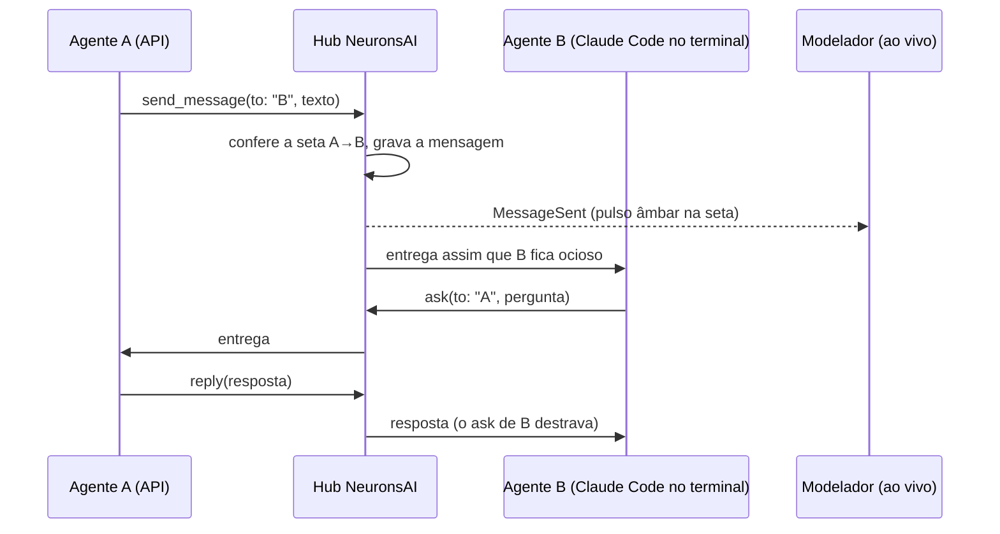
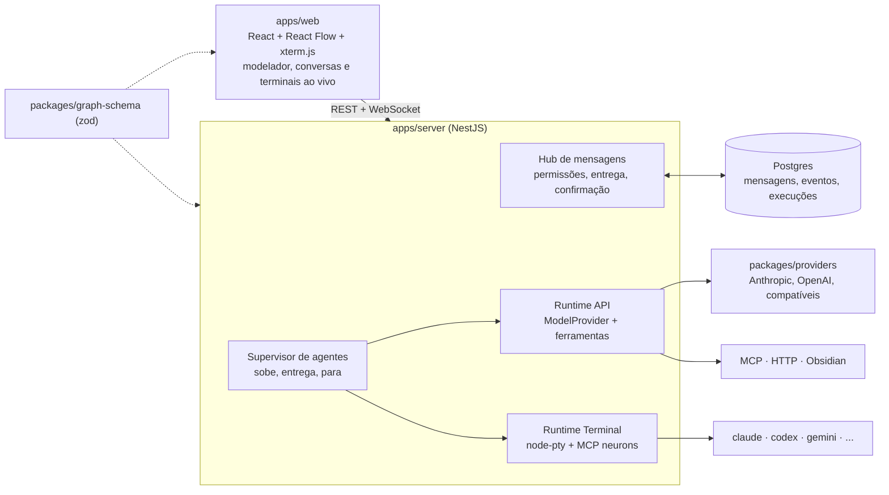

# NeuronsAI

Orquestrador visual de agentes de IA. Cada bloco do grafo é um agente independente do
fornecedor (nome/papel, contexto, modelo, esforço). **Agentes ligados por uma seta conversam
diretamente e em tempo real**, como os terminais do Orca, e tudo o que trocam fica visível
como no Camunda: quem falou com quem, o que cada um está fazendo agora e quanto custou.

## Referências e o que pegar de cada uma

| Referência | O que o NeuronsAI pega |
|---|---|
| Orca | Agentes vivos ao mesmo tempo, cada um na sua sessão (inclusive CLIs como Claude Code e Codex num terminal de verdade), mandando mensagens endereçadas uns aos outros, com caixa de entrada durável, confirmação de entrega e `ask` para pergunta com resposta |
| Camunda | Visibilidade: definição versionada, cada execução fixa uma versão, estado por bloco, histórico |
| n8n | Ligar agente a MCPs, APIs e gatilhos (webhook, WhatsApp) |
| Grok / "Graph Engineering" | Agentes com papéis diferentes repassando trabalho, inclusive em leque (1 pedido → N agentes → 1 resposta) |
| draw.io + Excalidraw | Modelador livre: além dos blocos, notas, formas, grupos e texto soltos |

**Diferença para o Orca:** o Orca é focado em código e numa relação coordenador → workers
montada por comandos. No NeuronsAI a **topologia é desenhada** (quem fala com quem), qualquer
tipo de agente entra (por API ou por CLI) e o fluxo pode não ter nada de código (vendas,
atendimento, pesquisa, integrações).

## Exemplos de fluxo (ilustrações, não escopo fixo)

- **Venda:** agente atende no WhatsApp → fecha a venda → avisa o agente de pós-venda, que
  chama as APIs de pedido e entrega e pode perguntar de volta ao vendedor algum detalhe.
- **Pesquisa:** agente de pesquisa consulta o cofre Obsidian e um MCP, conversa com um agente
  revisor até chegarem numa resposta.
- **Desenvolvimento:** um agente principal recebe o pedido e conversa com outros agentes
  (CLIs em terminais) que implementam e revisam.

## Como a comunicação funciona

- **Direto** do ponto de vista do agente: A escreve para B pelo nome, B recebe na própria
  sessão e responde, os dois vivos ao mesmo tempo. Ninguém no meio reinterpreta a mensagem,
  e não existe um "motor" decidindo quem roda depois.
- O **Hub** é só o carteiro: confere permissão, grava, entrega e avisa a tela. É ele que
  garante que nenhuma mensagem se perde e que tudo aparece no modelador.
- **Seta = permissão de iniciar conversa.** A→B deixa A escrever para B; B sempre pode
  responder a quem lhe escreveu. Seta dupla deixa os dois iniciarem.
- Cada agente recebe no início seu papel, seu contexto e a lista de **pares** (os blocos ligados
  a ele, com nome e papel).
- Ferramentas de comunicação de todo agente: `send_message(to, text)`, `ask(to, question)`
  (espera a resposta, com timeout), `reply(messageId, text)`, `list_peers()`, `finish(result)`.
- Mensagem que chega com o agente ocupado espera na caixa de entrada e é entregue quando ele
  termina o turno (no terminal: quando a CLI fica ociosa, como o `tui-idle` do Orca).
- Você também é um participante: dá para escrever para qualquer agente durante a execução.

## Decisões

| # | Decisão | Por quê |
|---|---|---|
| D1 | **TypeScript ponta a ponta** (Node 24 + NestJS no servidor, React + React Flow no modelador) — **confirmado pelo Rafael em 2026-11-01** | Esquema do grafo num pacote só (zod) para modelador e servidor; SDK oficial de MCP, `node-pty` e xterm.js são do ecossistema Node; NestJS tem módulos e injeção de dependência no estilo do Spring |
| D2 | **App desktop para Windows, macOS e Linux** (Electron): o servidor roda dentro do app em localhost e a interface abre na janela; em desenvolvimento também roda no navegador — **aprovado pelo Rafael em 2026-11-01** | Pedido do Rafael: baixar e instalar em qualquer sistema. Electron porque o servidor é Node (NestJS + `node-pty`) e roda no próprio processo do app, a mesma base do Orca; Tauri exigiria empacotar um Node à parte |
| D3 | **Comunicação direta entre agentes vivos** (modelo do Orca) | Pedido do Rafael. Cada agente é uma sessão de longa duração com caixa de entrada; não é um fluxo em que um bloco termina e o próximo começa |
| D4 | **Hub próprio**: toda mensagem é gravada no Postgres antes da entrega, entregue na hora em memória, e reentregue se não houve confirmação | Visibilidade e durabilidade sem infraestrutura extra (sem Temporal, Camunda, Redis). Postgres 18 nativo já está na máquina |
| D5 | **Dois tipos de agente** atrás da mesma interface `AgentRuntime`: **API** (loop próprio, qualquer fornecedor por chave de API) e **Terminal** (CLI oficial num pseudo-terminal: Claude Code, Codex, Gemini CLI, Hermes, qualquer uma) | O de API dá controle fino de modelo, esforço e custo. O de terminal usa a CLI oficial que você já tem logada, do mesmo jeito que o Orca, inclusive com a sua assinatura (termos, conferidos no spike T05: o usuário pode logar o binário não modificado com a própria assinatura; um produto não pode rotear requisições pela assinatura dos usuários nem guardar tokens; controle por PTY não é citado — para vender, o padrão é chave de API) |
| D6 | Agentes de terminal falam com o Hub por um **servidor MCP `neurons`** configurado em cada sessão | A CLI chama `send_message`/`ask` como ferramenta normal, sem raspar texto do terminal |
| D7 | **Esforço normalizado em 5 níveis**: `low`, `medium`, `high`, `xhigh`, `max` | São os níveis do Claude (`output_config.effort`); cada adaptador traduz (OpenAI `reasoning_effort`, Gemini orçamento de raciocínio, flag/config da CLI quando existir) e satura no mais próximo. "ultracode" não é parâmetro de API |
| D8 | **Canvas executável tipado + camada livre** | Blocos e setas tipados viram agentes e permissões; formas, notas, grupos e texto são anotação no mesmo canvas |
| D9 | **Grafo versionado e imutável por execução** | Igual à definição de processo do Camunda |
| D10 | **Guardas obrigatórias**: máximo de mensagens por seta e por execução, detecção de pingue-pongue, orçamento em US$, timeout por agente, botão de parar | Com conversa direta, dois agentes podem ficar se respondendo para sempre |
| D11 | Código, banco e enums em inglês; texto de tela em pt-BR | Regra dos projetos novos do Rafael |
| D12 | **Banco embutido no app: PGlite** (Postgres compilado para WASM), com o mesmo schema e as mesmas migrations do Drizzle; Postgres externo continua opcional (desenvolvimento, testes de integração, futuro modo servidor) — **aprovado pelo Rafael em 2026-11-01** | Quem baixa o app não vai instalar Postgres. PGlite é Postgres de verdade (SQL, triggers e migrations iguais) rodando dentro do processo, e o Drizzle tem driver para ele; SQLite obrigaria a reescrever schema e triggers |
| D13 | **Custos por último**: chave de API (T04, T07) e assinatura de código (T23) | Decisão do Rafael. Até lá os agentes rodam pelo Claude Code com a assinatura dele, e os instaladores saem sem assinatura (aviso do sistema na primeira abertura, como no MiniInfos) |

## Arquitetura (v1)

- **Monorepo pnpm + Turborepo**: `apps/web`, `apps/server`, `apps/site` (landing),
  `packages/graph-schema`, `packages/providers`, `packages/mcp-neurons`.
- **Banco:** Postgres 18 nativo (5432), database `neurons_dev`, Drizzle ORM com migrations.
- **Portas:** servidor 3100, web 5190, site 5191.
- **Distribuição:** instaladores para Windows (NSIS), macOS (dmg arm64 e x64) e Linux (AppImage e deb), gerados no GitHub Actions e publicados no GitHub Releases, com atualização automática.
- **Ciclo de uma execução:** o gatilho manda a primeira mensagem ao agente de entrada; cada
  agente sobe na primeira mensagem que recebe e fica vivo; a execução termina quando um agente
  chama `finish`, quando todos estão ociosos com a caixa vazia e ninguém esperando resposta,
  ou quando você para.
- **Eventos** (append-only): `RunStarted`, `AgentStarted`, `MessageSent`, `MessageDelivered`,
  `ToolCalled`, `UsageRecorded`, `AgentIdle`, `AgentFailed`, `RunFinished`. O modelador anima um
  pulso âmbar na seta a cada `MessageSent` (o mesmo pulso do neurônio da landing).

## Riscos

- **Mercado cheio:** n8n, Dify, Langflow, LangGraph Studio, Agent Builder da OpenAI, Orca e os
  multiagentes da Anthropic. Diferencial a defender: topologia desenhada, conversa direta entre
  agentes de qualquer fornecedor (API e CLI) e visibilidade nível Camunda.
- **Custo e laço infinito** com conversa livre: as guardas da D10 entram junto com o Hub, não depois.
- **Terminal no Windows:** provado no spike T05 (volta completa 3 de 3, ver `Docs/Spikes/Terminal.md`); o risco que sobra é a CLI mudar os textos de tela entre versões.
- **Injeção de prompt:** texto de fora (WhatsApp, páginas) chegando num agente com ferramentas.
  Agentes que recebem texto externo começam sem ferramenta de escrita.
- **WhatsApp:** só pela Cloud API oficial da Meta.
- **Multiplataforma:** o `node-pty` precisa ser recompilado para a versão do Electron em cada sistema (feito no CI); encerrar a árvore de processos muda por sistema (`taskkill` no Windows, grupo de processos no macOS/Linux); caminho e login do Claude Code CLI variam por sistema.

## Já existe

- Landing estática pronta em `E:\Notes\Design\NeuronsAI\pagina-real` (neurônio de partículas
  grafite com pulsos âmbar, Manrope, fundo `#F7F7F4`, sem azul).

Plano de execução: [[Plano de Implementação]].
